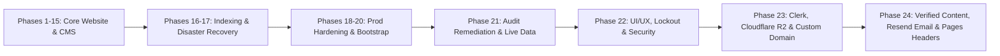
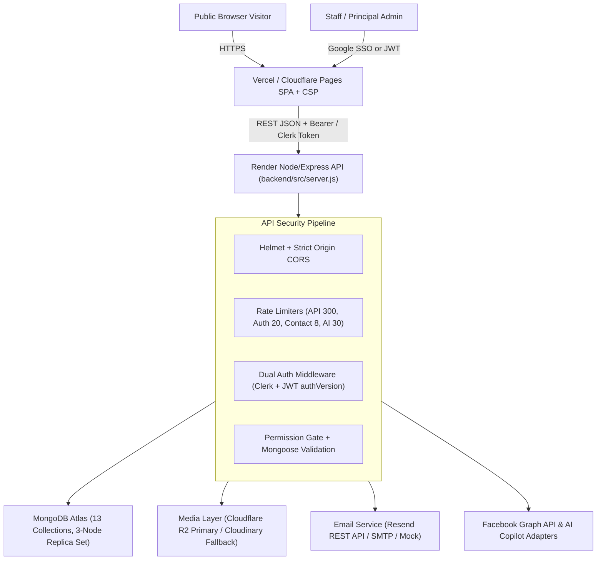

# Kaseni Model Secondary English School (KMES) — Complete Project Documentation & Master Report

**Document Version:** 2.0.0  
**Last Updated:** 2026-11-11  
**Project:** Kaseni Model Secondary English School (KMES) Official Website & Content Management System  
**Repository:** `https://github.com/saugat97120-eng/kmes-school.git`  
**Local Workspace:** `C:\Users\Dell\OneDrive\Desktop\KMES FILES\kmes-school`  
**Branch:** `main`  

---

## 1. Executive Summary & School Profile

The **KMES School Portal** is a full-stack public school website and role-governed Content Management System (CMS) built for **Kaseni Model Secondary English School**. It combines a public informational site (Home, About, Academics, Facilities, Activities, Notices, Events, Gallery, Achievements, Online Admissions Inquiry, and Contact) with a role-protected `/admin` editorial workspace featuring multi-stage content approval, audit trails, authentication security hardening, cloud object storage, and transactional email alerts.

### Verified School Details (Configured in Code & Letterhead)
* **Institution Name:** Kaseni Model Secondary English School (KMES)
* **Established:** 2059 B.S. (Nursery to Grade 10)
* **Academic Session:** 2081/2082
* **Address:** Belbari-05, Kaseni, Morang, Nepal
* **Principal:** Ivan Bhattarai
* **Contact Phones:** `+977 9842089044, 9817361024`
* **Primary Administration & Notification Email:** `ivanbhattarai042@gmail.com`
* **Official Facebook Page:** `https://www.facebook.com/61554117025008`
* **Institutional Identifiers (Letterhead):** PAN `601571219` · Regd. No. `00734`
* **Target Production Domains:** `https://kmes.edu.np` / `https://www.kmes.edu.np` (transitioned from `kmes.com.np` in commit `ea2c9b8`; pending Mercantile `.np` approval)
* **Live Staging/Hosting Endpoints:**
  * **Frontend (Vercel):** `https://kmes-school-xi.vercel.app` (and `https://kmes-school.vercel.app`)
  * **Backend API (Render):** `https://kmes-school-60eq.onrender.com`

---

## 2. Technology Stack

* **Frontend (`frontend/`):**
  * React `19.2.8`, React DOM `19.2.8`, React Router `7.18.2`
  * Vite `8.2.2` (`@vitejs/plugin-react`), Tailwind CSS `4.3.3` (`@tailwindcss/vite`)
  * `@clerk/react` `^6.17.8` (Google/Social SSO, `ClerkProvider`, `UserButton`, `OrganizationSwitcher`)
  * `lucide-react` `1.34.0`, Oxlint `1.79.0`
* **Backend (`backend/`):**
  * Node.js `>=18.0.0`, Express `5.2.1`, Mongoose `9.9.3`
  * MongoDB Atlas (`cluster0.njdpdb6.mongodb.net/kmes`) & `mongodb-memory-server` `11.2.0` (isolated offline testing)
  * Authentication & Security: `@clerk/express` `^2.1.78`, `jsonwebtoken` `9.0.3`, `bcryptjs` `3.0.3`, `helmet` `8.3.0`, `cors` `2.8.6`, `express-rate-limit` `8.7.0`, `express-validator` `7.3.2`
  * Media & File Uploads: `@aws-sdk/client-s3` `^3.1152.0` (Cloudflare R2 S3-compatible client), `cloudinary` `2.11.0`, `multer` `2.3.0`
  * Transactional Email: `resend` `^6.34.1`, `nodemailer` `10.0.0`
  * Utilities: `dotenv` `17.4.2`, `morgan` `1.11.0`

---

## 3. Complete Chronology of Engineering Work



### 3.1 Phases 1 – 20: Core Platform, Indexing, Disaster Recovery & Production Hardening
* **Core Monorepo (Phases 1–15):** Built 13 Mongoose models, CRUD factory (`backend/src/utils/crudFactory.js`), 5-stage editorial workflow (`draft` → `submitted` → `reviewed` → `approved` → `published`), granular RBAC (`backend/src/permissions.js`, `admin` vs `editor`), AI content assistant adapter (`backend/src/integrations/ai/`), and Facebook Graph API adapter (`backend/src/integrations/facebook/`).
* **Performance & Indexing (Phase 16):** Added composite indexes across workflow content and activity logs (`PHASE16_REPORT.md`).
* **Disaster Recovery (Phase 17):** Documented BSON/JSON backup and restore procedures in [`docs/DISASTER_RECOVERY.md`](docs/DISASTER_RECOVERY.md) and [`docs/RESTORE_CHECKLIST.md`](docs/RESTORE_CHECKLIST.md).
* **Production Auth & Infrastructure (Phases 18–20):**
  * Single-use SHA-256 hashed password reset tokens (`backend/src/utils/resetToken.js`) and session invalidation via `User.authVersion`.
  * Database-aware `/api/health` endpoint (`503` when MongoDB disconnects).
  * Concurrency-safe first-admin bootstrap (`backend/src/utils/adminBootstrap.js`) controlled by strict `ALLOW_ADMIN_BOOTSTRAP=true` and `ADMIN_BOOTSTRAP_EMAIL`.
  * Strict boot-time email provider validation (`assertEmailProviderConfiguration()`).

### 3.2 Phase 21: Review Remediation & Frontend Live Integration
* Added `backend/src/config/loadEnv.js` as the single non-overriding `.env` loader imported first in `server.js` and storage configs.
* Fixed bulk unpublish crash, enforced `http(s)` URL validation (blocking `javascript:` and `data:` URLs), preserved attachment subdocument `_id`s on save, added binary magic-number validation (`fileValidation.js`) for images and PDF/DOCX/ZIP attachments, escaped search regexes (`escapeRegex.js`), and rate-limited contact submissions.
* Connected all public homepage sections to live API endpoints and added `ScrollToTop`, SEO files (`robots.txt`, `sitemap.xml`), admin Leadership Management UI (`LeadershipManager.jsx`), and offline snapshot fallback in `backend/scripts/audit-content.mjs`.

### 3.3 Post-Phase 21 Security, UI/UX & Accessibility Upgrades (`dd3135d` – `72088e9`)
* **UI/UX Enhancements (`dd3135d`):**
  * Added [`EmergencyAlertBar.jsx`](frontend/src/components/common/EmergencyAlertBar.jsx) showing dynamic admission/session announcements with `sessionStorage` dismissal.
  * Added [`FloatingQuickContact.jsx`](frontend/src/components/common/FloatingQuickContact.jsx) with direct WhatsApp (`wa.me`), phone `tel:`, mailto, and office hours.
  * Added [`CardSkeleton.jsx`](frontend/src/components/common/CardSkeleton.jsx) loading placeholders across Notices, Events, Facilities, and Gallery.
  * Upgraded [`Admissions.jsx`](frontend/src/pages/Admissions.jsx) with a digital admission inquiry form generating printable confirmation slips with `KMES-YYYY-XXXX` Tracking IDs persisted through `/api/contact`.
* **Render & Dependency Hardening (`1c57d27`, `fd06b6d`):**
  * Added root `GET /` JSON health/metadata route on `server.js` to prevent `404` responses on Render platform probes.
  * Removed `nodemon` dev dependency and adopted Node native `node --watch src/server.js`.
* **Accessibility, Timing & Brute-Force Protection (`530fd8d`, `abde663`, `507596d`):**
  * Linked `htmlFor`, `id`, and `name` attributes in forms (`LeadershipManager.jsx`).
  * Restricted `express.json` and `express.urlencoded` payloads to `1mb`.
  * Added constant-time bcrypt dummy-hash comparison (`DUMMY_HASH`) on login when an email does not exist, preventing user-enumeration timing leaks.
  * Implemented **5-attempt account lockout** (`User.failedLoginAttempts`, `User.lockUntil`) locking accounts for 15 minutes (`HTTP 423`), with administrator unlock capability via `PUT /api/users/:id` (`{ unlock: true }`) and expanded audit logging (`login`, `login_failed`, `account_locked`) in `ActivityLog`.
  * Built automated verification in `backend/tests/security-lockout-audit.test.mjs` and updated UI views (`UsersManager.jsx`, `ActivityLogs.jsx`).
* **Reset Diagnostics & Bootstrap Alignment (`6f02188`, `72088e9`):**
  * Added safe diagnostic guidance in `AdminLogin.jsx` and `auth.routes.js` when email delivery uses mock/unconfigured SMTP.
  * Updated default `ADMIN_BOOTSTRAP_EMAIL` fallback in `backend/src/config/env.js` to `ivanbhattarai042@gmail.com`.

### 3.4 Clerk SSO, Organizations & Dual Authentication (`99bc0ff`, `4fb1440`, `ea2c9b8`)
* **Frontend Clerk Integration:**
  * Installed `@clerk/react` (`^6.17.8`) and wrapped the application in `<ClerkProvider>` inside [`frontend/src/main.jsx`](frontend/src/main.jsx) when `VITE_CLERK_PUBLISHABLE_KEY` is configured.
  * Linked Clerk Application `app_3KjhWHMkr5RB5HPtU2FAbrr8S9O` ("KMES School"), enabled Clerk Organizations, and configured Google OAuth Sign-In.
  * Updated [`frontend/src/admin/AdminLogin.jsx`](frontend/src/admin/AdminLogin.jsx) with `ClerkLoginSection` (`SignInButton` modal + `syncing` UI state) calling `POST /api/auth/clerk-sync`.
  * Updated [`frontend/src/admin/AdminLayout.jsx`](frontend/src/admin/AdminLayout.jsx) with `<Show when="signed-in">` wrapping `<OrganizationSwitcher />` and `<UserButton />`.
* **Backend Dual-Auth & Account Sync:**
  * Installed `@clerk/express` (`^2.1.78`) and mounted `clerkMiddleware()` in `server.js` when `CLERK_SECRET_KEY` is present.
  * Added `clerkUserId` field on `User` schema (`backend/src/models/User.js`).
  * Updated `requireAuth` (`backend/src/middleware/auth.js`) to accept Clerk session tokens first via `getAuth(req)` and fall back cleanly to traditional Bearer JWT + `authVersion` checks.
  * Implemented `POST /api/auth/clerk-sync` (`backend/src/routes/auth.routes.js`) mapping Clerk emails (`saugat97120@gmail.com`, `ivanbhattarai042@gmail.com`, bootstrap admin, or first DB user → `admin`; others → `editor`) to app JWT sessions and audit logs.
* **CSP Compatibility:** Updated Content Security Policy headers in `frontend/vercel.json` and `frontend/public/_headers` to permit Clerk (`https://*.clerk.accounts.dev`, `https://clerk.com`, `https://*.clerk.com`, `https://api.clerk.com`, `https://img.clerk.com`, `blob:` workers) and Cloudflare challenge scripts (`https://challenges.cloudflare.com`).

### 3.5 Cloudflare R2 Storage & Hybrid Fallback (`454539b`, `ea2c9b8`)
* **R2 Adapter (`backend/src/config/r2.js`):** Implemented S3-compatible client using `@aws-sdk/client-s3` targeting `https://<accountId>.r2.cloudflarestorage.com` with `uploadToR2()`, `deleteFromR2()`, and folder namespace (`media`, `attachments`, `gallery`).
* **Hybrid Route Wiring:** Updated [`upload.routes.js`](backend/src/routes/upload.routes.js), [`attachments.routes.js`](backend/src/routes/attachments.routes.js), [`media.routes.js`](backend/src/routes/media.routes.js), [`cloudinaryCleanup.js`](backend/src/utils/cloudinaryCleanup.js), and [`facebookService.js`](backend/src/integrations/facebook/facebookService.js):
  * Uses Cloudflare R2 whenever `R2_ACCESS_KEY_ID` and `R2_SECRET_ACCESS_KEY` are set.
  * Automatically falls back to Cloudinary (`isCloudinaryConfigured()`) when R2 keys are absent, keeping legacy Cloudinary URLs and current uploads 100% operational.
* **Operational Note on R2 Activation:** Live Cloudflare API testing confirmed that Cloudflare requires an active payment method on file to enable R2 billing (even for the 10 GB free tier). Until billing is enabled in Cloudflare, the backend cleanly operates using active Cloudinary credentials (`status: 'ok'`). Setup steps are documented in [`docs/R2_STORAGE_GUIDE.md`](docs/R2_STORAGE_GUIDE.md).

### 3.6 Custom Domain, DNS Automation & Mercantile Documentation (`bc2511c`, `bbc5225`, `ea2c9b8`)
* **Cloudflare DNS & Domain Whitelist:**
  * Automated Cloudflare DNS zone setup (`becky.ns.cloudflare.com` and `earl.ns.cloudflare.com`) pointing `@` (`76.76.21.21`), `www` (`cname.vercel-dns.com`), and `api` (`kmes-school-60eq.onrender.com`).
  * Added explicit CORS whitelist in [`backend/src/server.js`](backend/src/server.js) (`KMES_CUSTOM_DOMAINS`: `kmes.edu.np` and `www.kmes.edu.np` over HTTP/HTTPS).
  * Updated `frontend/public/sitemap.xml` and `frontend/public/robots.txt`, and added Cloudflare Pages SPA support via [`frontend/public/_redirects`](frontend/public/_redirects) and [`frontend/public/_headers`](frontend/public/_headers).
* **Mercantile Registration Documentation:**
  * Authored [`docs/DOMAIN_SETUP_GUIDE.md`](docs/DOMAIN_SETUP_GUIDE.md) and [`docs/MERCANTILE_COVER_LETTER.md`](docs/MERCANTILE_COVER_LETTER.md).
  * Reviewed and approved the school's official signed and rubber-stamped cover letter on institutional letterhead (PAN `601571219`, Regd. No. `00734`, Principal Ivan Bhattarai) for submission to `register.com.np`.

### 3.7 Verified School Details & Transactional Email via Resend (`e2c17ce`, `8c3783f`, `ea2c9b8`)
* **Verified Public Data (`e2c17ce`):**
  * Updated [`siteSettingsDefaults.js`](frontend/src/context/siteSettingsDefaults.js) with `Belbari-05, Kaseni, Morang`, `+977 9842089044, 9817361024`, `ivanbhattarai042@gmail.com`, and Principal `Ivan Bhattarai`.
  * Updated [`FloatingQuickContact.jsx`](frontend/src/components/common/FloatingQuickContact.jsx) and [`TopBar.jsx`](frontend/src/components/layout/TopBar.jsx) to extract the primary phone number safely before generating `tel:` and `https://wa.me/...` links.
  * Updated [`backend/src/seed.js`](backend/src/seed.js) with realistic school notices, events, facilities, and activities instead of placeholder text.
* **Resend Email Integration (`8c3783f`, `ea2c9b8`):**
  * Created [`backend/src/integrations/email/resendEmailAdapter.js`](backend/src/integrations/email/resendEmailAdapter.js) (`ResendEmailAdapter`, `ResendServiceError`) supporting HTML password resets, security notifications, and automated website inquiry/admission alerts (`sendInquiryNotification`).
  * Wired `resend` into [`emailService.js`](backend/src/integrations/email/emailService.js) (including syncing `activeConfig.provider` in `assertEmailProviderConfiguration()`) and triggered non-blocking inquiry email alerts from [`contact.routes.js`](backend/src/routes/contact.routes.js) targeting `ADMIN_NOTIFICATION_EMAIL` (default `ivanbhattarai042@gmail.com`).
  * Updated [`Admissions.jsx`](frontend/src/pages/Admissions.jsx) form submission metadata to route inquiries under `ivanbhattarai042@gmail.com`.
  * Added 5 automated unit assertions in [`backend/tests/resend.unit.mjs`](backend/tests/resend.unit.mjs).

---

## 4. Architecture & Data Overview



### 4.1 Database Collections (13 Mongoose Models)
1. `User` (`users`) — Name, email, bcrypt hash, role (`admin`/`editor`), `authVersion`, `passwordResetTokenHash`, `passwordResetExpires`, `failedLoginAttempts`, `lockUntil`, `clerkUserId`.
2. `Notice` (`notices`) — School notices/circulars, pinned flag, attachments, workflow status, soft delete.
3. `Event` (`events`) — Event dates, locations, cover images, workflow status.
4. `Facility` (`facilities`) — Campus facilities, descriptions, images, status.
5. `Activity` (`activities`) — Co-curricular programs, sports, scouts, clubs.
6. `Achievement` (`achievements`) — SEE & student honors, year, category.
7. `GalleryImage` (`galleryimages`) — Album photos, categories, R2/Cloudinary public IDs.
8. `SiteSettings` (`sitesettings`) — School branding, contact info, leadership copy, working hours, academic session.
9. `PageContent` (`pagecontents`) — CMS-managed page sections indexed by lowercase `slug`.
10. `ContactMessage` (`contactmessages`) — Visitor contact & online admission inquiries, read/archived flags.
11. `ActivityLog` (`activitylogs`) — Full audit log for auth (`login`, `login_failed`, `account_locked`), content, media, users, settings, Facebook, and AI.
12. `Media` (`media`) — Uploaded media asset registry (`url`, `publicId`, `filename`, `format`, `bytes`).
13. `FacebookSync` (`facebooksyncs`) — Import/publish deduplication logs with external ID tracking.

### 4.2 Mounted API Routes (`backend/src/server.js`)
* **Platform Health:** `GET /`, `GET /api/health`
* **Auth & Sync:** `POST /api/auth/register`, `POST /api/auth/login`, `GET /api/auth/me`, `POST /api/auth/forgot-password`, `POST /api/auth/reset-password`, `POST /api/auth/clerk-sync`
* **Public & CMS Content (`/api/{notices,events,gallery,achievements,facilities,activities}`):**
  * Public: `GET /`, `GET /:id`
  * Admin CRUD: `GET /admin/all`, `POST /`, `PUT /:id`, `DELETE /:id`, `GET /admin/trash`, `PUT /admin/trash/:id/restore`, `DELETE /admin/trash/:id`, `POST /admin/bulk-publish`, `POST /admin/bulk-trash`
  * Workflow: `POST /:id/{submit,review,approve,reject,publish,unpublish}`
* **Settings & Pages:** `/api/site-settings`, `/api/leadership`, `/api/page-content` (`GET /?slug=...`)
* **Inquiries & Administration:** `/api/contact` (`POST /` public; `GET /`, `PUT /:id`, `DELETE /:id` admin), `/api/inbox`, `/api/dashboard/stats`, `/api/users`, `/api/activity-logs`
* **Uploads & Media:** `POST /api/upload`, `POST /api/attachments/upload/:resource/:id`, `DELETE /api/attachments/:resource/:id/:attachmentId`, `GET /api/media`, `DELETE /api/media/:id`
* **Social & AI:** `/api/integrations/facebook/*` (`status`, `test-connection`, `posts`, `import`, `sync`, `publish`), `/api/ai/*` (`status`, `suggest`, `apply`)

### 4.3 Documentation Library (`docs/`)
* [`docs/DOMAIN_SETUP_GUIDE.md`](docs/DOMAIN_SETUP_GUIDE.md) — Cloudflare DNS, Mercantile delegation, Vercel & Render configuration (`kmes.edu.np`)
* [`docs/MERCANTILE_COVER_LETTER.md`](docs/MERCANTILE_COVER_LETTER.md) — Official `.np` domain application cover letter template & checklist
* [`docs/R2_STORAGE_GUIDE.md`](docs/R2_STORAGE_GUIDE.md) — Cloudflare R2 bucket (`kmes-school-media`) & `media.kmes.edu.np` guide
* [`docs/FACEBOOK_INTEGRATION_GUIDE.md`](docs/FACEBOOK_INTEGRATION_GUIDE.md) — Meta Graph API setup guide for Page ID `61554117025008`
* [`docs/DEPLOYMENT.md`](docs/DEPLOYMENT.md) — Full staging/production deployment runbook
* [`docs/PRODUCTION_RUNBOOK.md`](docs/PRODUCTION_RUNBOOK.md) & [`docs/FINAL_PRODUCTION_VERIFICATION.md`](docs/FINAL_PRODUCTION_VERIFICATION.md)
* [`docs/DISASTER_RECOVERY.md`](docs/DISASTER_RECOVERY.md) & [`docs/RESTORE_CHECKLIST.md`](docs/RESTORE_CHECKLIST.md)
* [`docs/PHASE19_PRODUCTION_VERIFICATION.md`](docs/PHASE19_PRODUCTION_VERIFICATION.md), [`docs/PHASE20_AUTH_HARDENING.md`](docs/PHASE20_AUTH_HARDENING.md), [`docs/PHASE21_REMEDIATION.md`](docs/PHASE21_REMEDIATION.md)

---

## 5. Verification Status (Observed on 2026-11-11)

All checks below were executed directly against the repository at commit `ea2c9b8`:

| Check / Suite | Command | Result | Notes |
| :--- | :--- | :--- | :--- |
| **Primary Backend Suite** | `npm test` (in `backend/`) | **141 PASS, 0 FAIL** | Phase 18C Unit (`40/40`), Phase 18C Integration (`49/49`), Phase 21 Regression (`33/33`), Lockout & Audit (`19/19`) |
| **Resend Email Unit Suite** | `node tests/resend.unit.mjs` | **5 PASS, 0 FAIL** | Verified missing key error, password reset, security alert, inquiry email, and provider switch |
| **Deployment Foundation** | `npm run test:foundation` | **20 PASS, 0 FAIL** | Verified seed guards, multi-origin CORS, env isolation |
| **RBAC Smoke Suite** | `npm run test:rbac` | **PASS** | All authorization smoke assertions passed |
| **Phase 20 Integration** | `node tests/phase-20.integration.mjs` | **20 PASS, 0 FAIL** | Registration closure, RBAC, password reset & notification |
| **Phase 20 Bootstrap** | `node tests/phase-20.bootstrap.mjs` | **12 PASS, 0 FAIL** | Concurrency-bounded first-admin registration lock |
| **Phase 20 Unit (Legacy)** | `node tests/phase-20.unit.mjs` | **17 PASS, 3 FAIL** | **Needs test update:** lines 46–55 still assert legacy `saugatb40@gmail.com` bootstrap email instead of `ivanbhattarai042@gmail.com`, and lines 108–110 test `"resend"` expecting it to be unsupported even though Resend is now supported |
| **Frontend Lint** | `npm run lint` (`oxlint src`) | **0 errors, 2 warnings** | Pre-existing React `set-state-in-effect` warnings in `AdminLogin.jsx:21` and `ActivityLogs.jsx:49` across 91 files |
| **Frontend Build** | `npm run build` (`vite build`) | **PASS** | Built `1962` modules cleanly in `1.19s` (`dist/assets/index-DenDaapL.js` `606.03 kB`, CSS `48.43 kB`) |

---

## 6. Current Operational Status & Pending Actions

### Working Today
1. **Frontend & Backend Deployments:** Vercel frontend and Render backend (`GET /api/health` returning `200`, MongoDB connected) are live.
2. **Clerk Auth & Organizations:** `ClerkProvider`, Google Sign-In, `OrganizationSwitcher`, `UserButton`, and `POST /api/auth/clerk-sync` are integrated with updated CSP rules.
3. **Media Uploads:** Cloudinary credentials ping `ok` (`rate_limit_allowed: 500`), serving uploads cleanly today; Cloudflare R2 adapter automatically activates as soon as R2 keys are provided.
4. **Email Architecture:** Resend adapter (`resendEmailAdapter.js`) is ready for `EMAIL_PROVIDER=resend` + `RESEND_API_KEY`.

### Remaining Administrator / External Actions
1. **Await Mercantile `.np` Domain Approval:** Stamped cover letter and institutional documents were submitted to `register.com.np`. Once approved, Cloudflare DNS records and Vercel/Cloudflare Pages domain verification will turn active with automatic SSL.
2. **Sync Live SiteSettings Record in Admin CMS:** Open `/admin/site-settings` on the live site and save the verified details (`+977 9842089044, 9817361024`, `ivanbhattarai042@gmail.com`, `Belbari-05, Kaseni, Morang`, Principal `Ivan Bhattarai`) so the live MongoDB `sitesettings` document matches the frontend defaults, and trigger a Vercel redeploy of commit `ea2c9b8` (or latest `main`).
3. **Activate Resend Key in Render:** Create a free API key at `resend.com` and set `EMAIL_PROVIDER=resend`, `RESEND_API_KEY=re_...`, and `ADMIN_NOTIFICATION_EMAIL=ivanbhattarai042@gmail.com` in Render Environment Variables.
4. **Connect Facebook Connections (Optional):**
   * Enable the **Facebook** Social Connection toggle in the Clerk Dashboard for 1-click Facebook admin login.
   * Generate a Meta Graph API Page Access Token for Page ID `61554117025008` and add `FACEBOOK_PAGE_ID` + `FACEBOOK_PAGE_ACCESS_TOKEN` to Render (per [`docs/FACEBOOK_INTEGRATION_GUIDE.md`](docs/FACEBOOK_INTEGRATION_GUIDE.md)).
5. **Cloudflare R2 (Optional):** If desired later, add a payment method in Cloudflare Billing to activate R2 free tier (10 GB), create bucket `kmes-school-media`, connect `media.kmes.edu.np`, and add `R2_ACCESS_KEY_ID` / `R2_SECRET_ACCESS_KEY` to Render.
6. **Populate Real Campus Content:** Replace seed/Unsplash placeholder images and test user `test.editor.phase4@kmes.edu.np` via `/admin` (as flagged by `npm run audit:content`).
7. **Update Stale Assertions in `backend/tests/phase-20.unit.mjs`:** Align bootstrap email test assertion and unknown-provider assertion with current `ivanbhattarai042@gmail.com` default and `resend` support so GitHub Actions CI passes `phase-20.unit.mjs`.

---

## 7. Complete Repository Git History (`234206b` → `ea2c9b8`)

```text
234206b chore: initial commit of KMES school website
3308fb2 feat: harden production authentication and health checks
36e9e27 docs: add Phase 18B report
1bf21d1 feat: establish production deployment foundation
363bb6c feat: establish staging environment foundation
a681efa chore: bump qs to fix audit advisory
caf15b7 fix: guard admin dashboard against missing fields for editor role
383b766 feat: complete Phase 18C production readiness
51d753b docs: add Phase 19 production verification report
abaa5b0 feat: harden first-admin bootstrap and enable smtp email
897c7d2 feat: complete final production verification
d29090a docs: record final read-only re-verification and operator handoff
c604a19 fix: clean frontend lint and settings context
ad83f07 chore: sync backend package-lock engine metadata
fa45077 feat: add forgot and reset password UI with email workflow
3cbb8c3 fix(cors): permit kmes-school vercel deployment origins
939be8d fix(api): return 400 Bad Request for malformed resource IDs (CastError)
338ec27 feat(seo): add robots.txt and sitemap.xml for production indexing
a96f097 fix(assets): replace broken Unsplash image URLs to eliminate CORB warnings
074b5e1 feat(cms): unify dynamic site settings and automatic updates across public pages
b73837d feat(leadership): add photo upload, admin leadership management, and resolve login form & csp audit issues
4a01eda fix(accessibility): add unique id and name attributes across all admin and public form fields
9b49778 fix(review): remediate backend security/stability defects and frontend live-data integration (Phase 21)
e63ac55 fix(lint): remove unused imports and refactor loadData in LeadershipManager
2b249b3 feat(audit): fall back to offline backup snapshot when MongoDB connection is unavailable
c5e6850 docs: add comprehensive project documentation from 1st to last (KMES_COMPLETE_PROJECT_REPORT.md)
b58e92b docs: expand master report with configuration checklist and advanced UI/UX roadmap
eb58f35 docs: integrate master documentation into root README.md from 1st to last
dd3135d feat(ui-ux): add emergency alert bar, floating quick contact, card skeleton loaders, and digital admission voucher slip
8256677 docs: sync git log in README and KMES_COMPLETE_PROJECT_REPORT
1c57d27 fix(render): add root endpoint to resolve 404 on health pings and patch security vulnerabilities
fd06b6d fix(deps): remove nodemon in favor of native node --watch and eliminate all 3 high severity vulnerabilities
530fd8d fix(accessibility): link htmlFor labels, add id/name attributes in LeadershipManager, and permit unsafe-eval in CSP
abde663 feat(security): add 1mb body limits and constant-time password comparison to prevent timing attacks
507596d feat(security): implement 5-attempt account lockout and audit logging for notices and users
6f02188 fix(auth): add clear diagnostic logs and UI guidance for password reset email delivery
72088e9 fix(env): update default admin bootstrap email to ivanbhattarai042@gmail.com
c983b73 docs: add comprehensive Facebook Integration and Automation Guide
bc2511c feat(domain): add kmes.com.np CORS whitelist, sitemap, and domain setup guide
99bc0ff feat(auth): integrate Clerk authentication with Google sign-in and dual JWT support
4fb1440 feat(clerk): enable organizations and add OrganizationSwitcher to admin navbar
454539b feat(storage): replace Cloudinary with Cloudflare R2 object storage for media and attachments
bbc5225 docs: add official Mercantile Communications cover letter template for kmes.com.np
e2c17ce feat(content): update verified school contact details, parse multi-phone numbers, and refine seed descriptions
8c3783f feat(email): integrate Resend email service for fast password resets and automated inquiry notifications to ivanbhattarai042@gmail.com
ea2c9b8 feat(integrations): fix Clerk login runtime state, add CSP for Clerk/Cloudflare, enable Cloudflare Pages _redirects, and finalize Resend email provider
```
