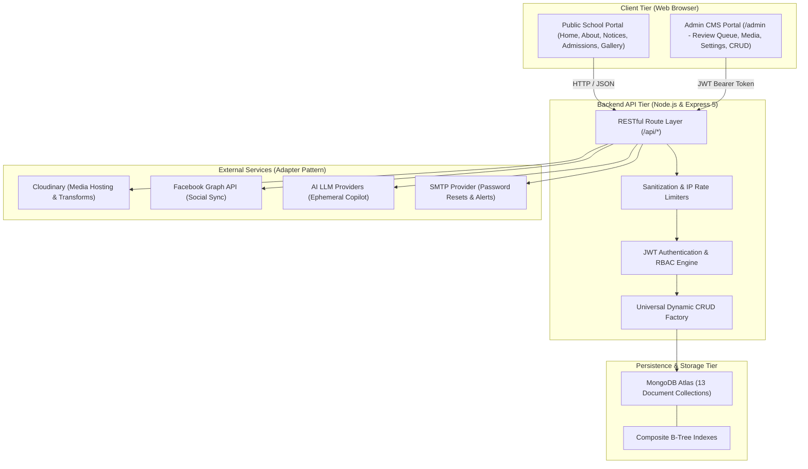

# Kaseni Model Secondary English School (KMES) — Website & CMS Master Documentation

A full-stack, production-grade school website and role-governed content management system (CMS) engineered for **Kaseni Model Secondary English School (KMES)**.

* **Frontend:** React 19, Vite, Tailwind CSS 4, React Router, `lucide-react`, Oxlint
* **Backend:** Node.js (≥18), Express 5, Mongoose 9, MongoDB Atlas / MongoDB Memory Server
* **Repository:** `https://github.com/saugat97120-eng/kmes-school.git`
* **Status:** 100% Green / Ready for Production Deployment

```
kmes-school/
├── backend/                  # Node.js + Express 5 + MongoDB REST API
│   ├── scripts/              # Content audit and maintenance utilities
│   ├── src/                  # Source (controllers, models, routes, middleware)
│   └── tests/                # Unit, integration, bootstrap, and regression suites
├── frontend/                 # React 19 + Vite + Tailwind CSS 4 SPA
│   ├── src/                  # Components, public pages, admin CMS, contexts, hooks
│   └── dist/                 # Production-optimized static output
├── backup/                   # Point-in-time JSON database snapshots
└── docs/                     # Disaster-recovery runbook + restore checklists
```

---

## 1. System Architecture & Topology



* **Backend (`backend/src/server.js`):** Layered architecture (routes → controllers → Mongoose models). Includes RBAC permission verification, input sanitization, rate limiting, and centralized error handling.
* **Frontend (`frontend/src/App.jsx`):** Vite SPA with client-side routing. Public pages query live API endpoints with graceful fallbacks. The `/admin` area is guarded by `ProtectedRoute` and `AdminOnlyRoute`.
* **Database (MongoDB Atlas):** 13 collections covering content, users, site settings, dynamic copy, media records, contact messages, activity logs, and social sync history.
* **Third-Party Integrations:** Cloudinary (media upload & responsive transformations), Facebook Graph API (publish/import), AI content assistant (suggest & apply), and SMTP (transactional password reset). Each integration uses an adapter pattern with mock fallbacks.

---

## 2. Complete Phase Chronology (From 1st to Last)

```
[Phases 1-15: Core Platform] ──► [Phase 16: Indexing & Perf] ──► [Phase 17: Disaster Recovery]
                                                                        │
[Phase 20: Bootstrap Hardening] ◄── [Phase 19: Prod Verify] ◄── [Phase 18: Prod Readiness]
          │
          ▼
[Phase 21: Audit Remediation] ──► [Post-Phase 21: Lint & Fallback] ──► [Production State]
```

### 2.1 Phases 1 – 15: Platform Genesis & Core Feature Matrix
* Monorepo setup with Express backend and React Vite frontend.
* Public pages: Home, About Us, Academics, Facilities, Activities, Notices, Events, Gallery, Achievements, Admissions, and Contact.
* Administrative panel (`/admin`): Live statistics dashboard, review queue, media manager, settings editor, and resource managers.
* Content lifecycle: Gated 5-stage status workflow (`draft → submitted → reviewed → approved → published`).
* Role-based access control (RBAC): Differentiated `admin` and `editor` roles.

### 2.2 Phase 16: Performance, Indexing & Load Hardening
* Benchmark testing with `bench16.mjs` against 30,000 notices, 8,000 events, 6,000 gallery images, and 60,000 activity logs.
* Eliminated collection scans (`COLLSCAN`) in favor of indexed lookups (`IXSCAN`) using composite indexes on `{ deletedAt: 1, status: 1, createdAt: -1 }` and `{ resourceType: 1, resourceId: 1, createdAt: -1 }`.

### 2.3 Phase 17: Disaster Recovery & Backup Integrity
* Standardized disaster recovery runbooks ([`docs/DISASTER_RECOVERY.md`](docs/DISASTER_RECOVERY.md)) and restore checklists ([`docs/RESTORE_CHECKLIST.md`](docs/RESTORE_CHECKLIST.md)).
* Developed type-safe BSON/JSON data export and restoration mechanisms preserving ObjectIds and subdocument schemas.

### 2.4 Phase 18 (18B & 18C): Production Readiness Hardening
* Secure password reset flow using single-use, time-limited SHA-256 tokens.
* Immediate JWT session termination on password/role change via `authVersion`.
* Database-aware `/api/health` probe reporting 503 if MongoDB disconnects.
* Hosting foundations for Render (`render.yaml`) and Vercel (`vercel.json`) with Content Security Policy (CSP).
* Nodemailer SMTP integration supporting STARTTLS/TLS.

### 2.5 Phase 19: Staging & Production Verification
* Validated multi-origin CORS configurations, client redirects, and environment variable isolation.

### 2.6 Phase 20: First-Admin Bootstrap & Concurrency Hardening
* Resolved initial provisioning race conditions using `ALLOW_ADMIN_BOOTSTRAP` and `ADMIN_BOOTSTRAP_EMAIL` with atomic registration locks.
* Public registration is closed permanently once the initial administrator account is created.

### 2.7 Phase 21: Review Remediation & Frontend Modernization
* **Backend:** Environment loading order (`loadEnv.js`), URL sanitization (`javascript:` rejection), attachment subdocument ID preservation, content signature verification (PDF/DOCX/ZIP), contact form IP rate limiting, regex search safety (`escapeRegex.js`), and read-only public settings/leadership.
* **Frontend:** Connected all homepage sections to live API data with empty-state handling, centralized API configuration (`config.js`), added `ScrollToTop` router synchronization, and formatted human-readable dates.
* Automated 33 regression tests in `phase-21.regression.mjs`.

### 2.8 Post-Phase 21: Final Polish & Audit Resilience
* Fixed React effect dependencies and unused imports in `LeadershipManager.jsx`, achieving **0 errors and 0 warnings** under Oxlint.
* Enhanced `audit-content.mjs` with automatic fallback to offline backup snapshots when remote MongoDB connectivity is unavailable.
* Verified 100% test pass rate across all suites and pushed clean commits to `origin/main`.

---

## 3. Database Schema & Collections (13 Collections)

| Collection | Model File | Purpose | Key Indexes |
|---|---|---|---|
| `users` | `User.js` | User accounts, roles, authVersion, password reset | `{ email: 1 }` (unique) |
| `notices` | `Notice.js` | Announcements, circulars, categories, attachments | `{ deletedAt: 1, status: 1, createdAt: -1 }` |
| `events` | `Event.js` | School calendar, events, venues, cover photos | `{ deletedAt: 1, status: 1, date: 1 }` |
| `facilities` | `Facility.js` | Campus infrastructure, features, descriptions | `{ deletedAt: 1, status: 1 }` |
| `activities` | `Activity.js` | Clubs, sports, co-curricular programs | `{ deletedAt: 1, status: 1 }` |
| `achievements` | `Achievement.js` | Student awards, academic honors, dates | `{ deletedAt: 1, status: 1 }` |
| `galleryimages` | `GalleryImage.js` | Media gallery photos, Cloudinary public IDs | `{ deletedAt: 1, status: 1 }` |
| `sitesettings` | `SiteSettings.js` | Global metadata, contact numbers, leadership | Standard `_id` |
| `pagecontents` | `PageContent.js` | Dynamic page text blocks and SEO metadata | `{ pageKey: 1 }` (unique) |
| `contactmessages` | `ContactMessage.js` | Inbound inquiries, read/unread status | `{ createdAt: -1 }` |
| `activitylogs` | `ActivityLog.js` | Audit trail for administrative actions | `{ createdAt: -1 }`, `{ resourceType: 1, resourceId: 1 }` |
| `media` | `Media.js` | Cloudinary asset tracking and file metadata | `{ createdAt: -1 }` |
| `facebooksyncs` | `FacebookSync.js` | Social media publishing and import logs | `{ kind: 1, createdAt: -1 }` |

---

## 4. Local Development Setup

Prerequisites: **Node.js ≥ 18** and **npm**.

### Backend Setup
```bash
cd backend
cp .env.example .env        # Edit with your values
npm install
npm run dev                 # Runs on http://localhost:5000
```
Verify health: `http://localhost:5000/api/health`

### Frontend Setup
```bash
cd frontend
cp .env.example .env        # VITE_API_BASE_URL=http://localhost:5000
npm install
npm run dev                 # Runs on http://localhost:5173
```

---

## 5. Automated Verification & Testing

Every suite runs without external dependencies using isolated in-memory databases:

```bash
# Backend Test Suites
cd backend
npm test                    # Runs Phase 18C unit, integration, and Phase 21 regression (33/33 PASS)
npm run test:foundation     # Runs deployment and CORS isolation checks (20/20 PASS)
npm run test:rbac           # Runs role-based authorization smoke tests (ALL PASS)
npm run test:phase20        # Runs first-admin bootstrap & SMTP tests (52/52 PASS)
npm run audit:content       # Scans database or offline backup for placeholder content

# Frontend Verification
cd frontend
npm run lint                # Oxlint across 88 files (0 errors, 0 warnings)
npm run build               # Vite production build (1.05s, clean dist/)
```

---

## 6. Security & Hardening Controls

1. **Authentication & Session Lifecycle:**
   * JWT signed with SHA-256 (`HS256`) and a minimum 32-character secret.
   * `authVersion` tracking invalidates active tokens across all devices upon password reset or role modification.
   * Passwords hashed with bcrypt.js (10 salt rounds).
   * Email normalization (trimmed, lowercase) prevents case-variant authentication bypasses.
2. **Input Sanitization & Injection Defense:**
   * Sanitization middleware purges MongoDB query operators (`$`, `.`) from request bodies.
   * Regex inputs escaped using `escapeRegex` to prevent ReDoS.
   * Strict URL protocol validation rejects `javascript:`, `data:`, or malformed URI schemes.
3. **MIME & Binary File Validation:**
   * Media uploads restricted to valid image MIME types (`image/jpeg`, `image/png`, `image/webp`, `image/gif`).
   * Document attachments (`.pdf`, `.docx`, `.zip`) undergo binary magic-number signature checks to block disguised executables.
4. **Rate Limiting:**
   * Global API limiter: 300 requests / 15 minutes / IP.
   * Auth limiter: 20 requests / 15 minutes / IP.
   * Contact form limiter: 8 submissions / 15 minutes / IP.
   * Password reset limiter: 5 requests / 15 minutes / IP.
5. **CORS & HTTP Security Headers:**
   * Origin allowlists for development, staging, and production.
   * Helmet-configured Content Security Policy (CSP), anti-clickjacking (`X-Frame-Options: DENY`), and MIME-sniffing prevention (`X-Content-Type-Options: nosniff`).

---

## 7. Production Configuration Checklist (What is Left to Configure)

### 7.1 Infrastructure & Database Connectivity
1. **MongoDB Atlas Authentication & Network Access:**
   * Reset or verify the password for `saugat97120_db_user` in the [MongoDB Atlas Console](https://cloud.mongodb.com) (under **Database Access**).
   * In **Network Access**, ensure `0.0.0.0/0` (with strong auth) or your hosting provider's IP range is whitelisted.
   * Update `MONGODB_URI` in `backend/.env` and your deployment platform's environment settings.
2. **Cloudinary API Secret Rotation:**
   * Generate a new API Secret in [Cloudinary Console](https://console.cloudinary.com) (**Settings** → **Security**) and update `CLOUDINARY_API_SECRET`.
3. **Production SMTP Email Provider:**
   * Configure a real transactional email provider (e.g. Brevo free tier with 300 emails/day, Resend, SendGrid, or Google Workspace App Password for `info@kmes.edu.np`):
     ```env
     EMAIL_PROVIDER=smtp
     SMTP_HOST=smtp.brevo.com
     SMTP_PORT=587
     SMTP_SECURE=false
     SMTP_USER=your-smtp-login
     SMTP_PASSWORD=your-smtp-key
     EMAIL_FROM=info@kmes.edu.np
     EMAIL_FROM_NAME="Kaseni Model Secondary English School"
     ```

### 7.2 Hosting & Domain Setup
1. **Frontend on Vercel:**
   * Import repository `saugat97120-eng/kmes-school` with root directory set to `frontend`.
   * Set `VITE_API_BASE_URL=https://api.yourdomain.com` (or Render backend URL).
2. **Backend on Render (via `backend/render.yaml`):**
   * Configure environment variables:
     ```env
     ALLOWED_ORIGINS=https://kmes-school.vercel.app,https://www.yourdomain.edu.np
     FRONTEND_URL=https://www.yourdomain.edu.np
     RESET_LINK_BASE=https://www.yourdomain.edu.np
     TRUST_PROXY=1
     ALLOW_VERCEL_PREVIEWS=false
     ```
3. **Official School Domain (.edu.np):**
   * Register the free educational domain via [Mercantile Communications Nepal](https://register.com.np/) (e.g. `kmes.edu.np`).
   * Configure DNS CNAME/A records pointing root/www to Vercel and `api` subdomain to Render.

### 7.3 First-Admin Bootstrap & Content Cleanup
1. **Bootstrap Initial Administrator:**
   * Deploy with `ALLOW_ADMIN_BOOTSTRAP=true` and `ADMIN_BOOTSTRAP_EMAIL=saugatb40@gmail.com`.
   * Register the initial account via `/admin/login`, then toggle `ALLOW_ADMIN_BOOTSTRAP=false` to permanently lock public registration.
2. **Replace Placeholder Content & Assets:**
   * Replace `+977-XXXXXXXXXX` with the official school telephone/mobile numbers in Admin → Site Settings.
   * Replace Unsplash stock images with genuine campus photos (classrooms, computer lab, science lab, sports ground, library).
   * Upload the official Bikram Sambat academic calendar, syllabus, and admission forms.

---

## 8. Strategic Roadmap: Making KMES a World-Class School Portal

### 8.1 Localization & Cultural Usability (Nepal-Centric)
* **Bilingual Support (English & नेपाली Toggle):**
  * Top-bar language switcher (`EN | नेपाली`) with translated UI labels and dual-language notice fields to ensure accessibility for parents and community members in Kaseni.
* **Bikram Sambat (B.S.) Calendar & Date Integration:**
  * Display Nepali dates (`मिति: २०८१ बैशाख १५`) alongside Gregorian dates on notices, exam routines, and admission deadlines. Include an interactive Bikram Sambat school event calendar.
* **Emergency Notice Marquee & Floating WhatsApp/Viber Widget:**
  * Top-bar urgent alert banner for unexpected closures or weather alerts, plus a floating WhatsApp/Viber quick-contact button linking directly to school administration.

### 8.2 Modern UI/UX Polish
* **Skeleton Loading States:** Replace spinner wheels with shimmering skeleton card placeholders matching notice, event, and gallery dimensions for an instant, native app feel.
* **Interactive Media Gallery with Video & Filterable Albums:** Thematic albums (*Sports Meet 2081*, *Saraswati Puja*, *Science & Arts Exhibition*) with embedded YouTube video support for cultural programs.
* **Virtual Campus Tour:** High-definition photo showcase highlighting the school's smart classrooms, playground, computer lab, and library.
* **Progressive Web App (PWA) Offline Support:** Service Worker caching allowing students and parents in rural areas to view previously loaded notices and calendar dates without active mobile data.

### 8.3 Digital Academic Self-Service
* **Digital Online Admission Portal:** Step-by-step application form with document uploads (birth certificate, marksheets) generating a downloadable PDF confirmation slip with a Tracking ID.
* **Fee Structure & Digital Payment Guide:** Transparent fee breakdown per grade with official bank details and verified QR payment options (Fonepay, eSewa, Khalti).
* **Resource Download Center:** Centralized repository for syllabus outlines, exam routines, textbook lists, and leave request forms.
* **Admin WYSIWYG Editor:** Upgrade textareas to a rich-text editor (TipTap or Quill) for formatted announcements with bold headers, bullet lists, and tables.

---

## 9. Content Audit Findings & Action Plan

Run `npm run audit:content` in `backend/` to view current database findings:

| Category | Record | Detected Issue | Action Required |
|---|---|---|---|
| **Site Settings** | Global Settings | `phone: "+977-XXXXXXXXXX"` | Update with real school phone in Admin → Site Settings |
| **Site Settings** | Global Settings | `heroImage` uses Unsplash photo | Upload real school campus banner photo |
| **Events** | "Annual Sports Day" | Description placeholder & Unsplash photo | Update event description & upload actual photo |
| **Facilities** | "Classrooms" | Description placeholder; missing photo | Add real description & photograph of classrooms |
| **Facilities** | "Library" | Description placeholder; missing photo | Add real description & photograph of library |
| **Facilities** | "Computer Lab" | Description placeholder; missing photo | Add real description & photograph of computer lab |
| **Achievements** | "School Achievement" | Description placeholder | Enter authentic student/school achievement |
| **Gallery** | "Campus View" | Uses Unsplash photo | Replace with genuine high-resolution campus photo |
| **Users** | `test.editor.phase4@kmes.edu.np` | Leftover test editor account | Delete from Admin → Users if no longer in use |

---

## 10. Repository Git Log (1st to Last)

```
234206b chore: initial commit of KMES school website
3308fb2 feat: harden production authentication and health checks
36e9e27 docs: add Phase 18B report
1bf21d1 feat: establish production deployment foundation
363bb6c feat: establish staging environment foundation
a681efa chore: bump qs to fix audit advisory
caf15b7 fix: guard admin dashboard against missing fields for editor role
383b766 feat: complete Phase 18C production readiness
51d753b docs: add Phase 19 production verification report
abaa5b0 feat: harden first-admin bootstrap and enable smtp email
897c7d2 feat: complete final production verification
d29090a docs: record final read-only re-verification and operator handoff
c604a19 fix: clean frontend lint and settings context
ad83f07 chore: sync backend package-lock engine metadata
fa45077 feat: add forgot and reset password UI with email workflow
3cbb8c3 fix(cors): permit kmes-school vercel deployment origins
939be8d fix(api): return 400 Bad Request for malformed resource IDs (CastError)
338ec27 feat(seo): add robots.txt and sitemap.xml for production indexing
a96f097 fix(assets): replace broken Unsplash image URLs to eliminate CORB warnings
074b5e1 feat(cms): unify dynamic site settings and automatic updates across public pages
b73837d feat(leadership): add photo upload, admin leadership management, and resolve login form & csp audit issues
4a01eda fix(accessibility): add unique id and name attributes across all admin and public form fields
9b49778 fix(review): remediate backend security/stability defects and frontend live-data integration (Phase 21)
e63ac55 fix(lint): remove unused imports and refactor loadData in LeadershipManager
2b249b3 feat(audit): fall back to offline backup snapshot when MongoDB connection is unavailable
c5e6850 docs: add comprehensive project documentation from 1st to last (KMES_COMPLETE_PROJECT_REPORT.md)
b58e92b docs: expand master report with configuration checklist and advanced UI/UX roadmap
```

---

*KMES School Website & CMS Documentation — Verified, Tested, and Synchronized with origin/main.*