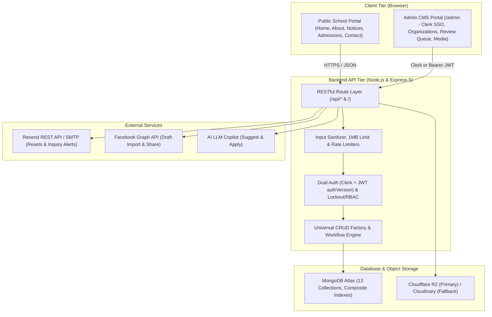

# Kaseni Model Secondary English School (KMES) — Website & CMS Documentation

A full-stack, production-shaped school website and role-governed content management system (CMS) built for **Kaseni Model Secondary English School (KMES)** — Belbari-05, Kaseni, Morang, Nepal (Est. 2059 B.S.).

* **Frontend:** React 19, Vite 8, Tailwind CSS 4, React Router 7, `@clerk/react`, `lucide-react`, Oxlint
* **Backend:** Node.js (≥18), Express 5, Mongoose 9, MongoDB Atlas, `@clerk/express`, `@aws-sdk/client-s3` (Cloudflare R2), Cloudinary, Resend, Nodemailer
* **Repository:** `https://github.com/saugat97120-eng/kmes-school.git`
* **Master Report:** [`KMES_COMPLETE_PROJECT_REPORT.md`](KMES_COMPLETE_PROJECT_REPORT.md)

```text
kmes-school/
├── backend/                        # Node.js + Express 5 + MongoDB REST API
│   ├── scripts/                    # Maintenance utilities (audit-content.mjs)
│   ├── src/
│   │   ├── config/                 # env.js, loadEnv.js, database.js, r2.js, cloudinary.js
│   │   ├── integrations/           # Email (Resend / SMTP / Mock), Facebook, AI Copilot
│   │   ├── middleware/             # Dual auth (Clerk + JWT), RBAC, uploads, sanitization
│   │   ├── models/                 # 13 Mongoose schemas
│   │   ├── routes/                 # Modular REST endpoints
│   │   ├── utils/                  # crudFactory, bootstrap lock, lockout/audit helpers
│   │   └── server.js               # Express app entrypoint & CORS/CSP setup
│   └── tests/                      # Unit, integration, bootstrap, regression, and security suites
├── frontend/                       # React 19 + Vite 8 + Tailwind CSS 4 SPA
│   ├── public/                     # _headers, _redirects, robots.txt, sitemap.xml
│   ├── src/                        # Public pages, admin CMS, hooks, contexts
│   └── vercel.json                 # Vercel CSP headers & SPA rewrites
├── backup/                         # Point-in-time JSON database snapshots
└── docs/                           # Guides, runbooks, and domain verification docs
    ├── DOMAIN_SETUP_GUIDE.md          # Custom domain setup guide (kmes.edu.np)
    ├── MERCANTILE_COVER_LETTER.md     # Official .np domain application cover letter template
    ├── R2_STORAGE_GUIDE.md            # Cloudflare R2 object storage guide (media.kmes.edu.np)
    ├── FACEBOOK_INTEGRATION_GUIDE.md  # Meta Graph API Page integration & publishing guide
    ├── DEPLOYMENT.md                  # Vercel & Render production operations guide
    ├── PRODUCTION_RUNBOOK.md          # Operator maintenance & daily procedures
    └── DISASTER_RECOVERY.md           # Database failover & point-in-time recovery
```

---

## 1. System Architecture & Topology



* **Backend (`backend/src/server.js`):** Layered REST API supporting dual authentication (`@clerk/express` + JWT `authVersion`), RBAC permissions, brute-force account lockout (`5` failed attempts → 15-minute `423` lock), IP rate limits, binary file signature validation, and strict CORS allowlists (including `kmes.edu.np` and `www.kmes.edu.np`).
* **Frontend (`frontend/src/App.jsx`):** Responsive React 19 SPA with Clerk Google Sign-In, Organization switching, Emergency Alert Bar, Floating Quick Contact (WhatsApp + multi-phone `tel:` parsing), skeleton loaders, and an interactive Online Admission Inquiry slip (`KMES-YYYY-XXXX`). Deployable on both Vercel (`frontend/vercel.json`) and Cloudflare Pages (`frontend/public/_headers`, `frontend/public/_redirects`).
* **Media Storage:** Hybrid storage adapter supporting **Cloudflare R2** (`backend/src/config/r2.js`, custom domain `media.kmes.edu.np`) with transparent fallback to **Cloudinary**.
* **Email Delivery:** **Resend** REST adapter (`backend/src/integrations/email/resendEmailAdapter.js`) plus **Nodemailer SMTP** adapter for password resets, security alerts, and automated website inquiry/admission emails to `ivanbhattarai042@gmail.com`.

---

## 2. Database Schema & Collections (13 Collections)

| Collection | Model File | Purpose | Key Indexes |
|---|---|---|---|
| `users` | `User.js` | User accounts, roles, `authVersion`, lockout & `clerkUserId` | `{ email: 1 }` (unique), `{ clerkUserId: 1 }` |
| `notices` | `Notice.js` | Announcements, circulars, attachments | `{ deletedAt: 1, status: 1, createdAt: -1 }` |
| `events` | `Event.js` | School calendar, events, venues, cover photos | `{ deletedAt: 1, status: 1, date: 1 }` |
| `facilities` | `Facility.js` | Campus infrastructure, features, descriptions | `{ deletedAt: 1, status: 1 }` |
| `activities` | `Activity.js` | Clubs, sports, co-curricular programs | `{ deletedAt: 1, status: 1 }` |
| `achievements` | `Achievement.js` | Student awards, academic honors, dates | `{ deletedAt: 1, status: 1 }` |
| `galleryimages` | `GalleryImage.js` | Media gallery photos, R2/Cloudinary public IDs | `{ deletedAt: 1, status: 1 }` |
| `sitesettings` | `SiteSettings.js` | School metadata, contact phones, address, leadership | Standard `_id` |
| `pagecontents` | `PageContent.js` | Dynamic page text blocks and SEO metadata | `{ slug: 1 }` (unique) |
| `contactmessages` | `ContactMessage.js` | Inbound inquiries, admission forms, read/archived flags | `{ createdAt: -1 }` |
| `activitylogs` | `ActivityLog.js` | Security & content audit trail | `{ createdAt: -1 }`, `{ resource: 1, resourceId: 1 }` |
| `media` | `Media.js` | Uploaded media metadata (`url`, `publicId`) | `{ createdAt: -1 }` |
| `facebooksyncs` | `FacebookSync.js` | Social media publishing and import logs | `{ kind: 1, createdAt: -1 }` |

---

## 3. Local Development Setup

Prerequisites: **Node.js ≥ 18** and **npm**.

### Backend Setup
```bash
cd backend
cp .env.example .env        # Configure MONGODB_URI, JWT_SECRET, CLERK_*, EMAIL_PROVIDER, etc.
npm install
npm run dev                 # Native node --watch on http://localhost:5000
```
Verify health: `http://localhost:5000/api/health` (or `http://localhost:5000/`)

### Frontend Setup
```bash
cd frontend
cp .env.example .env        # VITE_API_BASE_URL=http://localhost:5000, VITE_CLERK_PUBLISHABLE_KEY=...
npm install
npm run dev                 # Vite dev server on http://localhost:5173
```

---

## 4. Automated Verification & Testing

Suites run offline with isolated in-memory databases (`mongodb-memory-server`):

```bash
# Backend Tests
cd backend
npm test                         # Phase 18C Unit (40), 18C Integration (49), Phase 21 Regression (33), Lockout & Audit (19) -> 141 PASS, 0 FAIL
node tests/resend.unit.mjs       # Resend email adapter & inquiry notification checks -> 5 PASS, 0 FAIL
npm run test:foundation          # Deployment config & seed safety checks -> 20 PASS, 0 FAIL
npm run test:rbac                # Role-based authorization smoke tests -> PASS
node tests/phase-20.integration.mjs # Registration closure, RBAC, password reset -> 20 PASS, 0 FAIL
node tests/phase-20.bootstrap.mjs   # Concurrency-bounded first-admin bootstrap -> 12 PASS, 0 FAIL
npm run audit:content            # Scans MongoDB or offline ../backup snapshot for placeholder records

# Note: `node tests/phase-20.unit.mjs` currently reports 17 PASS / 3 FAIL because its assertions
# still check legacy `saugatb40@gmail.com` bootstrap default and expect `"resend"` to be unsupported.

# Frontend Verification
cd frontend
npm run lint                     # Oxlint across 91 files (0 errors, 2 pre-existing warnings)
npm run build                    # Vite production build (1962 modules -> clean dist/)
```

---

## 5. Production Checklist & Pending Operator Steps

1. **Custom Domain (`kmes.edu.np`):**
   * Stamped letterhead cover letter and supporting documents have been submitted to [Mercantile Communications](https://register.com.np/). Once approved, Cloudflare DNS (`becky.ns.cloudflare.com` / `earl.ns.cloudflare.com`) and Vercel/Pages SSL will activate automatically. See [`docs/DOMAIN_SETUP_GUIDE.md`](docs/DOMAIN_SETUP_GUIDE.md).
2. **Database Settings Sync & Frontend Redeploy:**
   * Update live **Site Settings** in `/admin/site-settings` (Phone: `+977 9842089044, 9817361024`, Email: `ivanbhattarai042@gmail.com`, Address: `Belbari-05, Kaseni, Morang`, Principal: `Ivan Bhattarai`) and redeploy the latest `main` commit on Vercel.
3. **Resend Email Activation (Render):**
   * Set `EMAIL_PROVIDER=resend`, `RESEND_API_KEY=re_...`, and `ADMIN_NOTIFICATION_EMAIL=ivanbhattarai042@gmail.com` in Render Environment Variables.
4. **Media Storage (R2 / Cloudinary):**
   * Cloudinary is active and tested healthy (`status: 'ok'`). To activate Cloudflare R2 (`media.kmes.edu.np`), enable R2 billing in Cloudflare Dashboard and add `R2_ACCESS_KEY_ID` + `R2_SECRET_ACCESS_KEY` in Render per [`docs/R2_STORAGE_GUIDE.md`](docs/R2_STORAGE_GUIDE.md).
5. **Facebook Connections (Optional):**
   * Enable Facebook in Clerk Dashboard Social Connections for 1-click SSO, and add `FACEBOOK_PAGE_ID=61554117025008` + `FACEBOOK_PAGE_ACCESS_TOKEN` in Render per [`docs/FACEBOOK_INTEGRATION_GUIDE.md`](docs/FACEBOOK_INTEGRATION_GUIDE.md).
6. **Replace Seed/Stock Content:**
   * Upload authentic school photos and remove any test accounts flagged by `npm run audit:content`.

---

## 6. Repository Git Log (Chronological)

```text
234206b chore: initial commit of KMES school website
3308fb2 feat: harden production authentication and health checks
36e9e27 docs: add Phase 18B report
1bf21d1 feat: establish production deployment foundation
363bb6c feat: establish staging environment foundation
a681efa chore: bump qs to fix audit advisory
caf15b7 fix: guard admin dashboard against missing fields for editor role
383b766 feat: complete Phase 18C production readiness
51d753b docs: add Phase 19 production verification report
abaa5b0 feat: harden first-admin bootstrap and enable smtp email
897c7d2 feat: complete final production verification
d29090a docs: record final read-only re-verification and operator handoff
c604a19 fix: clean frontend lint and settings context
ad83f07 chore: sync backend package-lock engine metadata
fa45077 feat: add forgot and reset password UI with email workflow
3cbb8c3 fix(cors): permit kmes-school vercel deployment origins
939be8d fix(api): return 400 Bad Request for malformed resource IDs (CastError)
338ec27 feat(seo): add robots.txt and sitemap.xml for production indexing
a96f097 fix(assets): replace broken Unsplash image URLs to eliminate CORB warnings
074b5e1 feat(cms): unify dynamic site settings and automatic updates across public pages
b73837d feat(leadership): add photo upload, admin leadership management, and resolve login form & csp audit issues
4a01eda fix(accessibility): add unique id and name attributes across all admin and public form fields
9b49778 fix(review): remediate backend security/stability defects and frontend live-data integration (Phase 21)
e63ac55 fix(lint): remove unused imports and refactor loadData in LeadershipManager
2b249b3 feat(audit): fall back to offline backup snapshot when MongoDB connection is unavailable
c5e6850 docs: add comprehensive project documentation from 1st to last (KMES_COMPLETE_PROJECT_REPORT.md)
b58e92b docs: expand master report with configuration checklist and advanced UI/UX roadmap
eb58f35 docs: integrate master documentation into root README.md from 1st to last
dd3135d feat(ui-ux): add emergency alert bar, floating quick contact, card skeleton loaders, and digital admission voucher slip
8256677 docs: sync git log in README and KMES_COMPLETE_PROJECT_REPORT
1c57d27 fix(render): add root endpoint to resolve 404 on health pings and patch security vulnerabilities
fd06b6d fix(deps): remove nodemon in favor of native node --watch and eliminate all 3 high severity vulnerabilities
530fd8d fix(accessibility): link htmlFor labels, add id/name attributes in LeadershipManager, and permit unsafe-eval in CSP
abde663 feat(security): add 1mb body limits and constant-time password comparison to prevent timing attacks
507596d feat(security): implement 5-attempt account lockout and audit logging for notices and users
6f02188 fix(auth): add clear diagnostic logs and UI guidance for password reset email delivery
72088e9 fix(env): update default admin bootstrap email to ivanbhattarai042@gmail.com
c983b73 docs: add comprehensive Facebook Integration and Automation Guide
bc2511c feat(domain): add kmes.com.np CORS whitelist, sitemap, and domain setup guide
99bc0ff feat(auth): integrate Clerk authentication with Google sign-in and dual JWT support
4fb1440 feat(clerk): enable organizations and add OrganizationSwitcher to admin navbar
454539b feat(storage): replace Cloudinary with Cloudflare R2 object storage for media and attachments
bbc5225 docs: add official Mercantile Communications cover letter template for kmes.com.np
e2c17ce feat(content): update verified school contact details, parse multi-phone numbers, and refine seed descriptions
8c3783f feat(email): integrate Resend email service for fast password resets and automated inquiry notifications to ivanbhattarai042@gmail.com
ea2c9b8 feat(integrations): fix Clerk login runtime state, add CSP for Clerk/Cloudflare, enable Cloudflare Pages _redirects, and finalize Resend email provider
```

---

*For the full detailed engineering report, API endpoints, verified checks, and chronological breakdown, see [`KMES_COMPLETE_PROJECT_REPORT.md`](KMES_COMPLETE_PROJECT_REPORT.md).*
