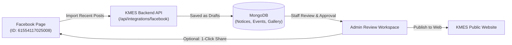

# Kaseni Model Secondary English School (KMES)
## Facebook Integration & Automation Guide

This guide provides step-by-step instructions for connecting the official **KMES Facebook Page** (`https://www.facebook.com/61554117025008`) to the KMES web application and admin portal.

---

## 1. Overview & Architecture

The KMES Facebook integration bridges the school's social media presence with the official web portal:

### Key Capabilities
* **Import to Website**: Pull recent Facebook posts with photos, videos, captions, and permalinks into the CMS as **drafts**.
* **Publish to Facebook**: Publish approved school notices and event announcements directly to the KMES Facebook Page feed with a single click.
* **Duplicate Protection**: Tracks Facebook post IDs (`externalId`) with sparse indexing to guarantee posts are never imported twice.
* **Human Gatekeeper Security**: Imported social posts **never** publish directly to the live site; they always start as `draft` for editorial review.

---

## 2. Configuration Parameters

The backend requires the following environment variables:

| Variable Name | Required | Description | Example / Production Value |
| :--- | :---: | :--- | :--- |
| `FACEBOOK_PAGE_ID` | **Yes** | The numeric ID of the KMES Facebook Page | `61554117025008` |
| `FACEBOOK_PAGE_ACCESS_TOKEN` | **Yes** | Meta Graph API Page Access Token | `EAA...` (long alphanumeric token) |
| `FACEBOOK_APP_ID` | Optional | Meta Developer App ID | `123456789012345` |
| `FACEBOOK_APP_SECRET` | Optional | Meta Developer App Secret | `a1b2c3d4e5...` |

---

## 3. Step-by-Step Meta Setup Guide

### Step 3.1: Log In as Facebook Page Admin
Ensure you are logged into Facebook with an account that has **Full Control** or **Content Management** permissions for the KMES School Facebook Page:
👉 [https://www.facebook.com/61554117025008](https://www.facebook.com/61554117025008)

---

### Step 3.2: Create a Meta Developer App
1. Navigate to **[Meta for Developers](https://developers.facebook.com/)**.
2. Click **My Apps** in the top-right corner.
3. Click **Create App**:
   - Choose **Other** (or Business).
   - Select App Type: **Business**.
   - Set Display Name: `KMES School Portal`.
   - Enter your contact email and click **Create App**.

---

### Step 3.3: Generate Page Access Token via Graph API Explorer
1. Open the **[Meta Graph API Explorer](https://developers.facebook.com/tools/explorer/)**.
2. In the top-right panel:
   - **Meta App**: Select `KMES School Portal`.
   - **User or Page**: Click the dropdown and select **Page Access Token**.
   - From the list of Pages, choose **Kaseni Model Secondary English School**.
3. Under **Permissions**, add the following 3 permissions:
   - `pages_show_list` (allows discovery of managed pages)
   - `pages_read_engagement` (allows reading page posts, attachments, photos)
   - `pages_manage_posts` (allows publishing notices from website to Facebook)
4. Click **Generate Access Token** and grant permissions in the Facebook popup.
5. Copy the generated token string.

---

### Step 3.4: Generate a Never-Expiring Long-Lived Token (Recommended)
By default, Graph API Explorer tokens expire after 1 hour. To make the token permanent:

1. Open the **[Access Token Debugger](https://developers.facebook.com/tools/debug/accesstoken/)**.
2. Paste the token from Step 3.3 and click **Debug**.
3. Scroll to the bottom and click **Extend Access Token**.
4. Meta will generate a **60-day or never-expiring Page Access Token**.
5. Copy this long-lived token.

---

## 4. Deploying to Production (Render)

Add the variables to your live backend on Render:

1. Go to **[Render Dashboard](https://dashboard.render.com)**.
2. Click on your backend web service: **`kmes-school-60eq`**.
3. Click the **Environment** tab on the left.
4. Add the following key-value pairs:
   - `FACEBOOK_PAGE_ID` = `61554117025008`
   - `FACEBOOK_PAGE_ACCESS_TOKEN` = `[Paste your Page Access Token here]`
   - `FACEBOOK_APP_ID` = `[Optional: Your Meta App ID]`
   - `FACEBOOK_APP_SECRET` = `[Optional: Your Meta App Secret]`
5. Click **Save Changes**. Render will automatically restart and deploy the integration.

---

## 5. How to Use the Facebook Admin Features

### 5.1 Connection Verification
1. Log in to the KMES Admin Portal: [https://kmes-school-xi.vercel.app/admin/login](https://kmes-school-xi.vercel.app/admin/login).
2. In the sidebar, navigate to **Facebook Integration** (`/admin/facebook`).
3. Click **"Test Connection"**:
   - ✅ **Green Badge ("Connected")**: Confirms your backend successfully reached Meta Graph API and retrieved the Page details.
   - ❌ **Red Badge ("Not Connected")**: Displays the exact error code (e.g., `invalid_token`, `expired_token`, or `network`).

---

### 5.2 Importing Facebook Posts into Website CMS
1. On the **Facebook Integration** page, set the post fetch limit (e.g., 10 or 25).
2. Click **"Load Posts"** to preview recent Facebook posts without publishing anything.
3. Select which content type you wish to target:
   - **Notices**: Academic announcements, exam schedules, holidays.
   - **Events**: Sports day, annual celebrations, parent-teacher meetings.
   - **Gallery**: School photos and activities.
4. Select individual posts with checkboxes and click **"Import Selected"**, or click **"Sync Facebook"** to automatically import all new posts.
5. The imported posts will appear under your **Content Inbox** and respective manager panels as **Drafts**.

---

### 5.3 Publishing Website Notices to Facebook
1. Open any approved/published Notice or Event in the **Review Workspace** (`/admin/review/:type/:id`).
2. Scroll to the **Facebook Publishing** section.
3. Review the preview card and optional custom caption.
4. Click **"Publish to Facebook"**:
   - The notice text and attachment images are posted to the official KMES Facebook Page feed.
   - The post's Facebook ID is permanently stamped on the CMS record (`facebookPublication.publishedId`) to prevent duplicate accidental republishing.

---

## 6. Security Controls & Guarantees

| Security Measure | Implementation Details |
| :--- | :--- |
| **Strict Token Concealment** | Access tokens are read exclusively in the backend environment. They are never sent to the browser or echoed in responses. |
| **RBAC Authorization** | Access to Facebook features is restricted by granular permissions: `social.view`, `social.import`, `social.manage`, `social.publish`. |
| **Timeout Protection** | Meta Graph API requests enforce a 12-second abort timeout so slow external networks never hang the Node.js server. |
| **Attachment URL Sanitization** | Image and video URLs undergo `safeUrl()` validation to block malicious pseudo-protocols (`javascript:`, `data:`). |
| **Audit Trail** | Every sync, import, connection test, and publication is permanently recorded in [`ActivityLog`](file:///C:/Users/Dell/OneDrive/Desktop/KMES%20FILES/kmes-school/backend/src/models/ActivityLog.js). |

---

## 7. Troubleshooting & FAQs

### Error: `invalid_token` or `session has expired`
- **Cause**: The Page Access Token was invalidated (e.g. Facebook account password was changed or a temporary token expired).
- **Fix**: Re-generate a Page Access Token in the Graph API Explorer and update `FACEBOOK_PAGE_ACCESS_TOKEN` on Render.

### Error: `rate_limit`
- **Cause**: Meta Graph API limit reached due to too many rapid requests.
- **Fix**: The backend automatically bounds requests (maximum 50 posts per query). Wait 15 minutes for the quota to reset.

### No posts appear when clicking "Load Posts"
- **Cause**: The Page Access Token lacks `pages_read_engagement` permission, or the Page ID does not match the token's authorized page.
- **Fix**: Verify that `FACEBOOK_PAGE_ID` is set to `61554117025008` and the token was issued for this specific page.
